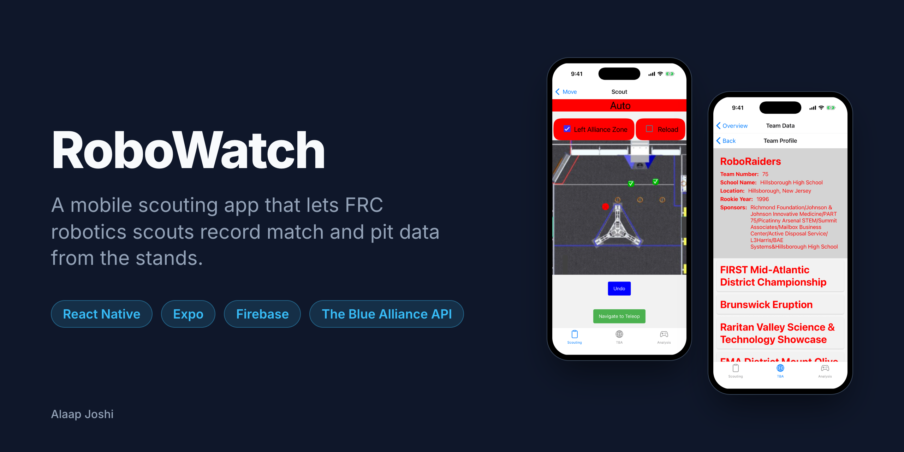
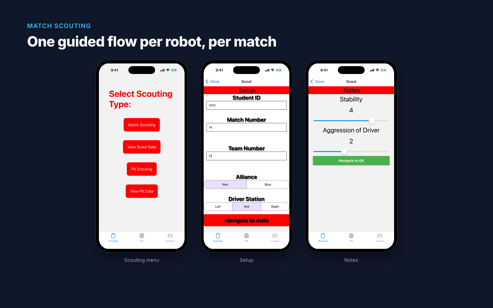
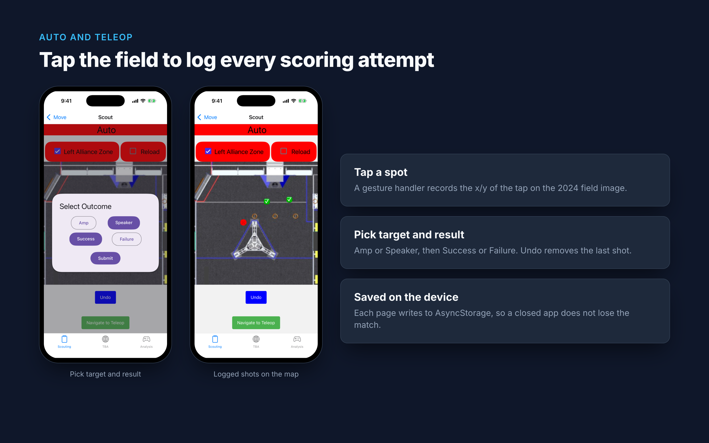
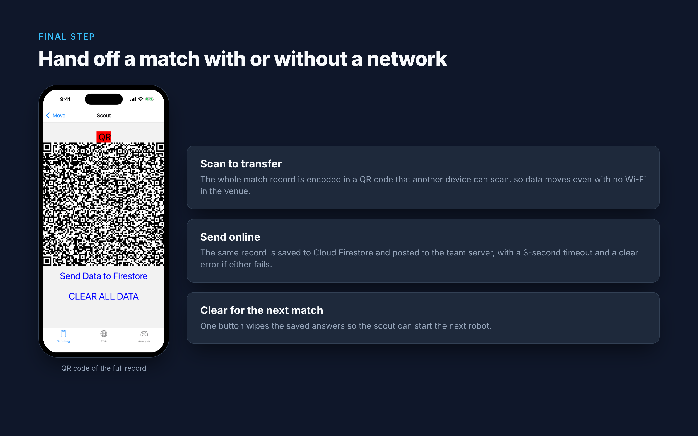
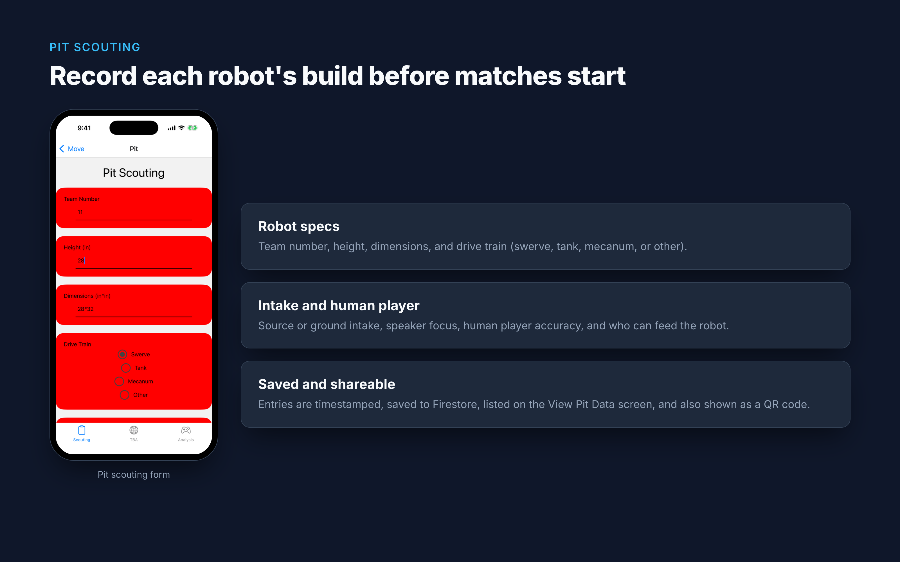
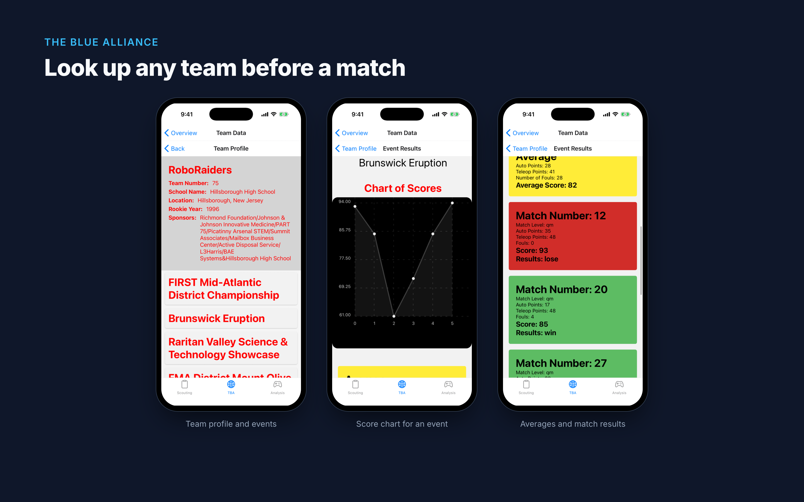
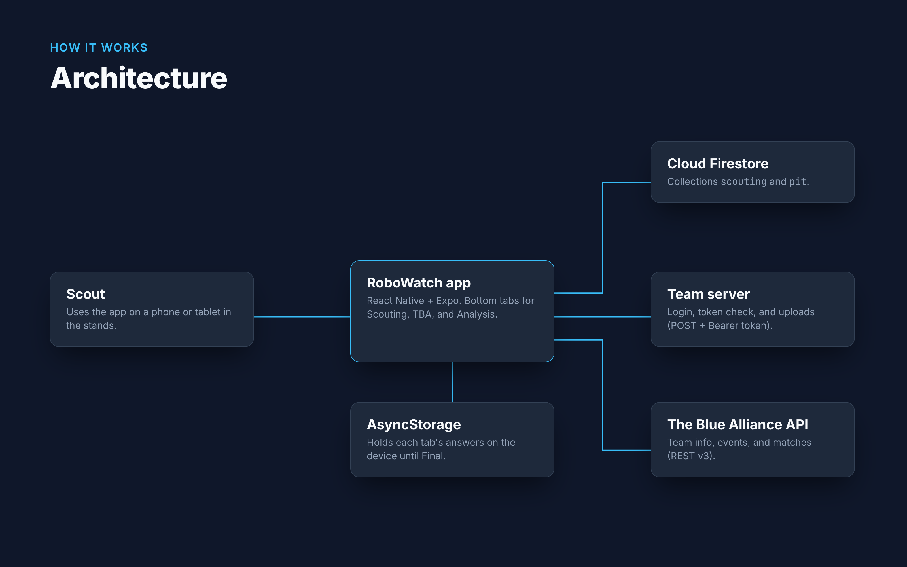

# RoboWatch

> A mobile scouting app that lets FIRST Robotics Competition (FRC) scouts record match and pit data from the stands.

   

## About

FRC teams choose alliance partners based on how other robots actually perform, so students sit in the stands and record every match. RoboWatch replaces paper scouting sheets with a phone app. Scouts step through a guided form for each robot, tap the field map to mark where it scored, and hand off the result as a QR code or upload it to Firestore. It also pulls live team and match history from The Blue Alliance API, so scouts can look up an opponent before a match. I built it for FRC Team 75 (RoboRaiders) for the 2024 season.

## Features

- Guides scouts through a six-step match form: Setup, Auto, Teleop, Endgame, Notes, and Final.
- Logs each scoring attempt by tapping the field map, then recording the target (Amp or Speaker) and the result (Success or Failure), with undo.
- Saves every step on the device, so closing the app mid-match loses nothing.
- Encodes the finished record as a QR code for offline handoff, and uploads it to Cloud Firestore and the team server.
- Records pit scouting data: robot size, drive train, intake type, and human player accuracy.
- Looks up any team on The Blue Alliance and shows its events, per-match scores, averages, and a score chart.

## Gallery

<table>
  <tr>
    <td width="50%"> The guided match scouting flow</td>
    <td width="50%"> Tap-to-log scoring on the 2024 field map</td>
  </tr>
  <tr>
    <td width="50%"> QR handoff and upload</td>
    <td width="50%"> Pit scouting form</td>
  </tr>
  <tr>
    <td width="50%"> Live team lookup through The Blue Alliance</td>
    <td width="50%"> How the app connects to its data sources</td>
  </tr>
</table>

Screenshots are from the app running in the iOS Simulator with sample scouting data and live Blue Alliance data.

## Tech Stack

| Layer | Technology |
|---|---|
| Frontend | React Native 0.73, Expo SDK 50, React Navigation, React Native Paper |
| Backend | Team scouting server (REST with bearer-token auth) |
| Database | Cloud Firestore, AsyncStorage (on device) |
| Tools | The Blue Alliance API v3, react-native-chart-kit, react-native-qrcode-svg, EAS Build |

## Getting Started

### Prerequisites

- Node.js 18+
- Xcode with an iOS Simulator, Android Studio with an emulator, or a phone with Expo Go for SDK 50
- A free Blue Alliance read API key from [thebluealliance.com/account](https://www.thebluealliance.com/account)

### Installation

~~~bash
git clone https://github.com/alaapjoshi/RoboWatch.git
cd RoboWatch
npm install
cp .env.example .env
~~~

Open `.env` and paste your Blue Alliance key:

~~~bash
EXPO_PUBLIC_TBA_API_KEY=your_key_here
~~~

### Usage

~~~bash
npx expo start --offline
~~~

Press `i` for the iOS Simulator or `a` for an Android emulator, or scan the QR code with Expo Go. The app opens on three tabs:

- **Scouting**: *Match Scouting* starts the match form, *Pit Scouting* opens the pit form, and *View Scout Data* and *View Pit Data* list saved entries from Firestore.
- **TBA**: *Team data* lets you enter a team number (for example `75`) to see its profile, events, scores, and chart.
- **Analysis**: placeholder for future work.

On launch the app checks in with the team server. Outside the team's network you will see "Server is not responding". Tap OK and everything else still works.

## Project Structure

~~~text
RoboWatch/
  App.jsx                 # entry point: splash screen, bottom tabs, navigation
  config.js               # reads the Blue Alliance key from .env
  scouting/
    navigatescout.jsx     # scouting menu and team-server sign-in
    scout/pages/          # match form: setup, auto, teleop, endgame, notes, final
    scout/viewscout.jsx   # saved match entries from Firestore
    pit/                  # pit form and saved pit entries
  TBA/                    # Blue Alliance team lookup, matches, rankings, charts
  analysis/               # analysis tab (placeholder)
  settings/               # accent color and dark mode (not linked into navigation yet)
  assets/                 # app icon and splash screen
  docs/images/            # README images and their HTML sources
~~~

## How It Works

The app is one Expo project with a bottom tab navigator, and each tab has its own stack navigator. The match form is a set of tabs, and each step writes its answers to AsyncStorage as the scout moves on. When the Final tab opens, it reads every key back into one record and renders it as a QR code with `react-native-qrcode-svg`. The same record is written to the `scouting` collection in Firestore and POSTed to the team server with a bearer token. Network calls race against a 3-second timeout so the app shows an error instead of hanging in a crowded venue. On the Auto and Teleop pages, a tap gesture handler on the field image captures the tap's x/y position. A dialog then asks for the target and result, and the point is added to a list that can be undone.

~~~mermaid
flowchart LR
  Scout --> App[RoboWatch app]
  App <--> Local[(AsyncStorage)]
  App -->|addDoc / getDocs| FS[(Cloud Firestore)]
  App -->|POST + bearer token| Server[Team server]
  App -->|GET /api/v3| TBA[The Blue Alliance API]
~~~

## Future Improvements

- Build out the Analysis tab from saved scouting data, for example per-team scoring heatmaps from the tap locations.
- Queue uploads while offline and send them when the device reconnects.
- Share one Firebase setup module instead of setting it up again in several screens.
- Move the team server address into configuration, like the Blue Alliance key.

## Author

**Alaap Joshi** - Computer Science + Cognitive Science, Rutgers University-New Brunswick
[GitHub](https://github.com/alaapjoshi) | [LinkedIn](https://linkedin.com/in/alaapjoshi)

## License

MIT. See [LICENSE](LICENSE).
